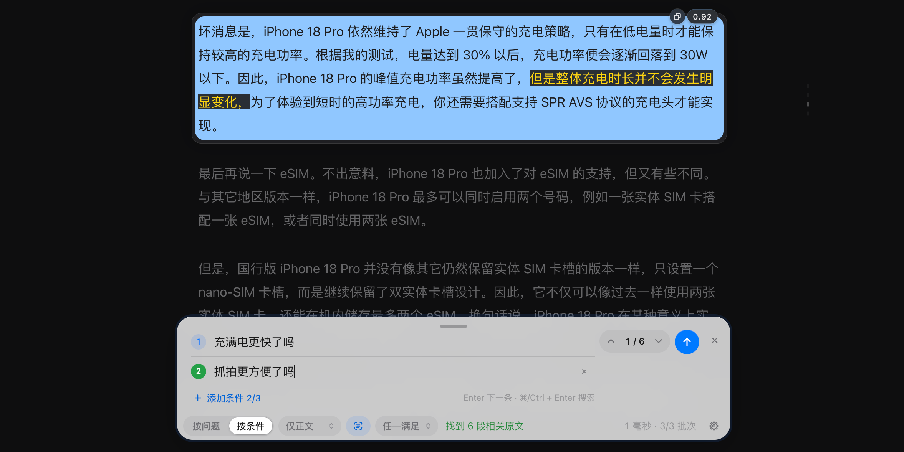
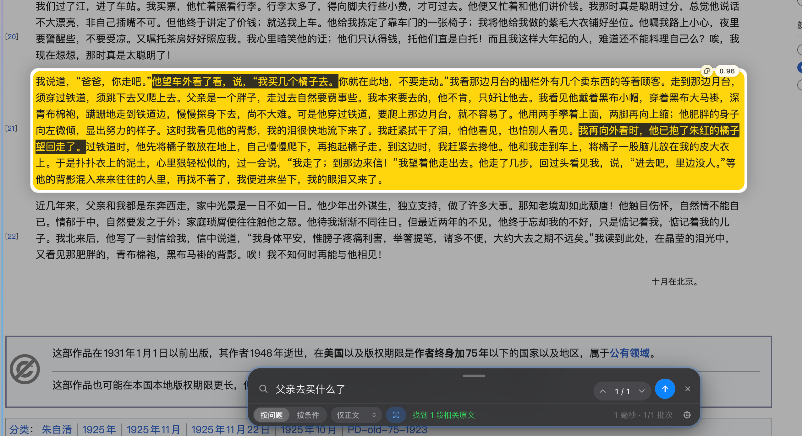

# 感应式查找

**记不住关键词，也能用问题找到原文。**

感应式查找是一款浏览器扩展。阅读网页时，你可以直接输入想了解的问题，或列出筛选条件；扩展会在当前页面中找出相关段落、标出出处，并带你跳到原文。它也能搜索有文字层的 PDF 和 Word 文档。

它适合查找评测里的实际测试、技术文档中的操作说明、协议里的额外费用，以及更新日志中可能影响旧配置的改动。需要核对作者或原文具体怎么说时，可以用它定位出处；需要总结和综合回答时，也可以搭配侧边栏 AI 搜索。

搜索使用 Jev 判断模型。感应式查找负责筛选、排序、高亮和跳转，不生成新的答案或文章总结。扩展代码免费开源；使用搜索需要配置自己的 API Key，服务商可能按用量收费。

## 功能预览

按条件查找原文：

按问题查找原文：

## 安装

需要 Node.js 20.19+、22.13+ 或 24+。

~~~sh
git clone https://github.com/knockkeykey/inductive-search.git
cd inductive-search
npm ci
npm run build
~~~

构建完成后，在浏览器扩展管理页加载对应目录：

- **Chrome / Edge**：打开 **chrome://extensions** 或 **edge://extensions**，启用开发者模式，选择“加载未打包的扩展程序”，加载 **dist/chrome**。
- **Firefox**：打开 **about:debugging#/runtime/this-firefox**，选择“临时加载附加组件”，加载 **dist/firefox/manifest.json**。
- **Safari**：构建会生成 **dist/safari**，但此目录的 Safari 运行效果尚未验证。

更新代码后重新构建并在扩展管理页重新加载；已经打开的网页建议刷新。

## 配置服务商

打开扩展设置，选择服务商，填入对应的 API Key 并保存。密钥和模型会按服务商分别保存在本机扩展存储中。

| 服务商 | 获取 API Key | 默认模型 |
| --- | --- | --- |
| TypeSafe | [TypeSafe 控制台](https://console.typesafe.ai/keys) | **jev-latest** |
| OpenRouter | [OpenRouter 密钥设置](https://openrouter.ai/settings/keys) | **~typesafe/jev-latest** |
| 自定义中转站 | 由你使用的中转站提供 | 无，需按中转站提供的模型名选择或填写 |

模型菜单会提供该服务商支持的 Jev 模型。OpenRouter 还可选择 **typesafe/jev-1.13**。

选择“自定义中转站”时，需要填写中转站地址（根地址即可，例如 `https://api.example.com`）、该中转站的 API Key 和模型名。扩展会向 `{地址}/v1/systemone` 发送请求；如果中转站提供 `/v1/models`，设置页会把其中的 Jev 模型列成菜单，默认选中第一个，菜单最后的“手动输入…”可填写列表里没有的模型名；读取不到列表时直接填写模型名。不同中转站的模型名可能不同，例如有的不提供 `jev-latest`，请以中转站的说明为准。保存时浏览器会请求访问该地址的权限。填好后可以点“测试连接”：它用当前填写的内容（不必先保存）发送一次只含示例文字的请求，并显示是否连通、实际响应的模型和耗时；失败时显示服务商返回的原始错误。这是一次真实请求，可能按用量计费。

这些服务商都使用 Jev 的 System One 决策接口。GPT、Claude 等普通聊天模型不能直接替代 Jev，只提供 OpenAI 兼容聊天接口的中转站也无法使用。搜索只会发送到你当前选择的服务商。

在查找栏的设置面板里可以看到当前服务商和配置状态，点击“修改”会打开扩展设置页。API Key 只在扩展设置页填写，不会在网页里输入。

## 开始查找

默认快捷键是 macOS 上的 **Option + F**，其他平台上的 **Ctrl + Shift + F**。也可以点击浏览器工具栏中的“感应式查找”图标。普通的 **Cmd/Ctrl + F** 仍由浏览器处理。

快捷键可在扩展设置中修改；Chrome 会跳转到扩展快捷键设置页。

### 按问题查找

选择“按问题”，输入你真正想知道的内容，例如：

- “父亲去买什么了？”
- “新 iPhone 充满电快了吗？”
- “作者实际测试过哪些功能？”

按 Enter 或点击“搜索”。结果按相关度排序，符合条件的原文会在页面中高亮并显示分数；扩展会滚动到最相关的段落。分数是模型对段落相关性的判断，适合辅助定位和排序，不代表事实正确率。

有结果时，按 Enter 或 ↓ 查看下一个结果，按 Shift + Enter 或 ↑ 查看上一个结果。也可以点击查找栏中的上下按钮，或点击页面右侧的结果标记。修改搜索内容后按 Enter 会提交新搜索。搜索框、中文输入法和条件编辑保留各自的输入操作。

### 按条件查找

选择“按条件”，每行输入一个条件，最多三个。例如：

~~~text
作者实际进行过测试
给出了具体数据
~~~

“全部满足”会筛选同一文字块中每项条件都达到阈值的结果；“任一满足”会保留至少一项达到阈值的文字块。证据分散在不同段落时，不会自动合并判断为同一段满足全部条件。

同一结果的颜色对应得分最高的那个条件。组合分数用于筛选和排序：“全部满足”取各条件中的最低分，“任一满足”取最高分。这是查找用的排序分数，不是多个条件同时成立的校准概率。

### 选择搜索范围

搜索范围默认为“仅正文”，也可以选择：

- **仅正文**：优先读取网页的正文区域；网页没有清楚标记正文时会退回整页。自动识别可能不准确。
- **整页**：读取页面中可见的文字。
- **当前选区**：先在网页中划选文字，再打开查找并选择当前选区，只搜索所选文字。

正文和整页搜索可读取开放 Shadow DOM 与同源 iframe 中的可见内容。跨域 iframe、封闭 Shadow DOM、表单输入内容和尚未加载的内容不会被读取。

搜索完成后页面又加载了新内容时，查找栏会提示“新增 N”。点击后才会把新增文字提交搜索；页面变化不会自动发送请求。部分批次请求失败时，可以选择重试未返回分数的文字块。

## 搜索 PDF 与 Word

- **网页 PDF**：在浏览器打开 PDF 后，按快捷键或点击扩展图标，会在内置文档查看器中打开并提取文字。首次读取某个网站的 PDF 时，浏览器会请求该网站的读取权限。
- **本地文件**：在扩展设置中选择“在文档查看器中打开”，选择或拖入 PDF、Word（.docx）文件。
- PDF 结果会标注页码；Word 文档会保留标题、列表和表格结构。
- 不支持旧版 **.doc**、扫描版或纯图片 PDF（没有 OCR）。PDF 多栏、表格和脚注等复杂排版可能影响段落划分；加密 PDF 会提示输入密码。

文档在本机读取和转换，只有点击“搜索”后，提取的文字才会发送给所选服务商。

## 相关度与段内定位

段落相关度阈值默认是 0.4，可在 0.2–0.7 之间调整。降低阈值会显示更多结果，也可能带来更多不相关段落；提高阈值会减少结果，也可能漏掉表达方式不同的相关段落。调整阈值只会重新筛选已有分数，不会重新请求。

默认开启“段内精确定位”。它会对排名靠前的结果再次逐句判断，并在段落中加深标出最多两句，帮助你更快看到关键内容。这一步会额外请求模型；不足 80 个字符、少于三句话、标题、表格行和当前选区不会进行句子定位。可以在设置中关闭或调整句子阈值。

## 实现方式与适用边界

扩展读取当前选定范围的可见文字，将内容拆成文字块，再请 Jev 判断哪些文字块符合问题或条件。拿到分数后，扩展负责筛选、排序、定位和高亮。按问题查找时还会在本地匹配关键词，作为语义结果之外的补充；关键词匹配不会改变模型分数。

网页和文档里的原文是结果依据。模型分数表示相关性判断，不验证原文真假，也不保证每次都找全。搜索质量会受网页结构、文档排版、模型和服务商影响。

扩展不会预先在每个网页注入脚本；只有打开查找时，才会向当前标签页注入脚本。页面文字只会在你主动提交搜索后发送给服务商。受浏览器保护的页面（如 **chrome://**、**about:** 和扩展商店）无法使用。浏览器内置 PDF 阅读器不能直接进行页面搜索，扩展会改用自己的文档查看器。

## 隐私

提交搜索时，扩展会向所选服务商发送当前范围的文字、搜索问题或条件、页面标题和网址。API Key 会用于对应服务商的请求。扩展没有自己的搜索服务器，也不使用分析或遥测；搜索结果不会保存。

关闭查找会取消客户端请求，但服务商已经收到的请求仍可能继续处理或产生费用。完整的数据处理和权限说明见[隐私政策](PRIVACY.md)。

## 开发与验证

~~~sh
npm ci
npm test
npm run check
npm run watch
~~~

**npm run check** 会依次运行类型检查、Biome 检查、构建和 Firefox 扩展校验。自动测试使用模拟 API；通过测试不能证明真实服务商的可用额度、延迟或实际命中质量。实际使用效果需要用自己的 API Key 在目标网页或文档中确认。

## 上游项目与许可证

本项目基于 [tymscar/hunch](https://github.com/tymscar/hunch) 继续开发，由 [knockkeykey](https://github.com/knockkeykey) 维护。原作者 Oscar Molnar 的 MIT 许可证见 [LICENSE](LICENSE)。
